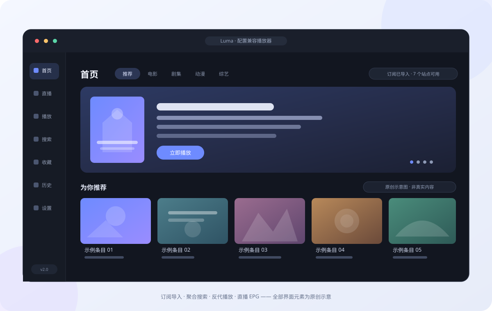
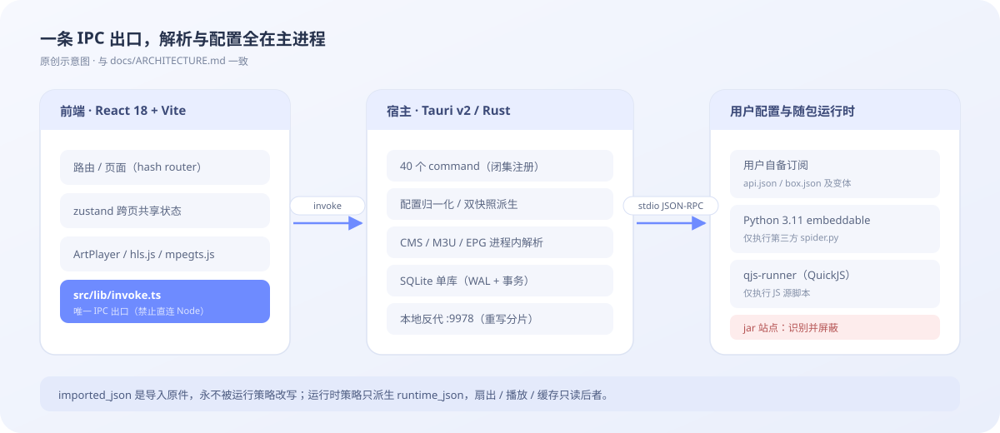
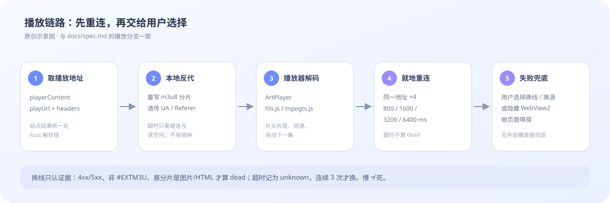

# Luma

Windows 11 x64 上的 TVBox 兼容播放器。本身不内置、不托管、不分发任何订阅地址或影视源，
内容全部来自用户导入的配置（`api.json` / `box.json` 及常见变体）。

React 18 + TypeScript + Vite · Tauri v2（Rust）· WebView2 · Python 3.11 / QuickJS sidecar

> 本项目只提供播放框架，不提供任何音视频内容或源站地址。导入的配置与脚本由使用者自行
> 判断合法性并承担使用责任。不收集遥测、不上传配置、不内置账号体系。



*上图为原创绘制的界面示意：所有条目均为占位内容，不含真实片源、海报或任何第三方版权素材。*

## 功能

- **订阅导入**：URL / 本地文件 / 内联文本，兼容 JSONC、base64 图片种、gzip 包装等方言。
  多个订阅各自独立的收藏、历史与页面缓存，可设定时刷新。
- **源适配**：CMS 采集、Python（`base.spider` 框架）、JavaScript（drpy2 / `var spider`，
  独立 `qjs-runner` 进程）；jar 站点在导入时识别并屏蔽。
- **聚合搜索**：一次关键词覆盖当前配置全部站点，按站流式上屏、可中断，失败按原因分组
  并支持单站重试。
- **播放**：ArtPlayer + hls.js / mpegts.js；本地反代重写 m3u8 相对分片并透传
  UA / Referer / Cookie。失败先在同一地址按退避重连 4 次；仍失败则上报，由用户选择
  换线 / 换源，页面型地址可走隐藏 WebView2 嗅探。支持播放偏好记忆与自动下一集。
- **直播**：m3u / m3u8 解析与代理重写、多线路切换、XMLTV EPG、台标。
- **数据**：SQLite 单库（配置快照 / active / 收藏 / 历史），WAL 模式。
- **诊断**：三通道结构化日志（按天轮转、URL 脱敏）、一键复制诊断信息、打开日志目录、
  导出反馈文件。
- **存储清理**：设置页显示日志、反馈报告、封面与页面缓存的真实占用，可分项清理。
- **自动更新**：启动后每日检查一次；清单与安装包走 GitHub 加速通道，校验 SHA256 后
  静默安装，有新版只在侧栏轻提示。

## 支持范围

| 能力 | 状态 | 说明 |
|---|---|---|
| CMS 采集（`api.php/provide/vod`） | ✅ | 主流配置的主体，直链 m3u8 |
| Python（TVBox `base.spider`） | ✅ | 含直链型与 `proxy?do=py` 型 |
| JavaScript（drpy2 / `var spider`） | ✅ | 独立 `qjs-runner`，内置 ESM 加载器与 8 个随包库 |
| `parses[]` 解析池 | ✅ | type 0 嗅探 / 1 JSON 接口 / 4 并行竞速 |
| 配置级 `headers[]` | ✅ | 按 host 注入 UA / Referer |
| 直播（`lives`） | ✅ | m3u8 经本地代理重写后播放 |
| jar（`csp_*` / 全局 `spider` jar） | ❌ | 社区 jar 是 Android dex，依赖 Android 运行时，在 Windows x64 无法执行；导入时标记 `runtime=jvm` 并屏蔽 |

## 架构一览

前端只有一条 IPC 出口；配置解密、归一化、站点路由与 m3u8 / EPG 解析都在 Rust 主进程内完成。
Python 与 QuickJS 两个 sidecar 只执行用户自备的第三方源脚本，通过 stdio JSON-RPC 通信。



## 播放链路

播放失败先重连同一地址，不把「慢」误判为「死」；是否换线 / 换源由用户在界面上决定。



## 系统要求

| 用途 | 要求 |
|---|---|
| 运行 | Windows 11 x64；WebView2 常青版（系统自带） |
| 开发 | Node 20+ / pnpm 9；Rust stable ≥ 1.77.2（`x86_64-pc-windows-msvc`）；VS2022 Build Tools + Windows SDK |

## 安装

从 [Releases](https://github.com/neo-fan/luma/releases) 下载 `Luma_<version>_x64-setup.exe`，
双击按向导安装。未签名安装器首次运行可能触发 SmartScreen：选择「更多信息 → 仍要运行」。

启动后进入 设置 → 导入订阅（粘贴地址或选择本地文件），即可在首页 / 分类 / 搜索浏览，
详情页选择线路与剧集播放；直播页单独导入 m3u 源。

## 数据与日志

| 通道 | 数据目录 |
|---|---|
| stable | `%APPDATA%\app.luma\` |
| beta | `%APPDATA%\app.luma.beta\` |
| dev | `%APPDATA%\app.luma.dev\` |

- 数据库：`luma.db`（SQLite，可能伴随 `-wal` / `-shm`）。
- `LUMA_DATA_DIR` 可覆盖以上默认值。
- 日志：`logs\app\`、`logs\ui\`、`logs\spider\` 三个通道，按天轮转，各保留最近 7 份，
  单通道上限 10 MiB。日志只记 `scheme + host + path`，查询参数与播放直链不落盘。

## 构建

打包使用 Tauri 官方工具链：`prepare_runtime.py` 只准备 Python embeddable / qjs-runner
这些 sidecar，构建本身交给 `tauri build`。

```powershell
corepack pnpm install                # 依赖（pnpm 版本由 package.json 锁定）
python tools/prepare_runtime.py      # 准备随包运行时
corepack pnpm dev:app                # debug：热重载窗口 + CDP 9222
corepack pnpm build:app              # release：嵌入前端并产出 NSIS 安装包
```

产物：debug 为 `src-tauri/target/debug/Luma_dev.exe`，release 安装器在
`src-tauri/target/release/bundle/nsis/`。裸 `cargo build --release` 不会嵌入前端，
发版一律走 `tauri build`。

测试：

```powershell
python tools/affected.py --run         # 日常：按改动半径只跑受影响的
python tools/check.py                  # 全量离线回归：跨模块 / 改契约 / 发版前
corepack pnpm test                     # 前端单测
cargo test --manifest-path src-tauri/Cargo.toml --lib
node tools/run_probes.mjs --list       # 窗口探针清单（需 debug 窗口 + CDP 9222）
```

## 环境变量

| 变量 | 用途 |
|---|---|
| `LUMA_DATA_DIR` | 覆盖数据目录（默认 `%APPDATA%\<identifier>`） |
| `LUMA_LOG` | 日志级别：`trace` / `debug` / `info` / `warn` / `error` / `off`，默认 `info` |
| `LUMA_PYTHON` | 覆盖 Python 解释器（默认随包 `python-embed`，其次 `python`） |
| `LUMA_QJS_RUNNER` | 覆盖 `qjs-runner.exe` 路径 |
| `LUMA_RESOURCE_DIR` | 发布给 sidecar 的资源目录，通常无需设置 |
| `LUMA_PROXY_PORT` | 本地反代端口（stable 9978 / beta 9977 / dev 9979） |
| `LUMA_PROXY_ALLOW_LOCAL` | `1` 时允许反代访问 `127.0.0.1`，仅本地联调用 |
| `LUMA_SELFCHECK` | `1` 时启动自检并写 `<data>\selfcheck.log` |

## 已知限制

- jar 站点（`runtime=jvm`）只做识别与屏蔽，任何情况下都不会被执行。
- `parses[]` 仅实现 type 0 / 1 / 4；type 2 / 3 依赖 jar 反射，直接返回「不支持」。
- 源若返回源作者本机的服务地址（如 `127.0.0.1:10010`）不可用：客户端只放行自身反代
  （`127.0.0.1:<端口>/proxy`），其余 loopback 地址被 SSRF 防护拒绝。
- 公开解析接口与源站失效频繁，属正常现象；解析池失败保留原地址，由内置嗅探兜底。
- JS 源尚未覆盖 drpy2 `initEnv` 完整 polyfill 与 FongMi 新版 class-based `Spider`。
- 不支持外部播放器（mpv 通道已移除）、`luma://` 协议关联、JumpList 与全屏勿扰。

## 文档

- [项目主页](https://neo-fan.github.io/luma/) —— GitHub Pages 静态站点，本页内容的网页版
- [docs/ARCHITECTURE.md](docs/ARCHITECTURE.md) —— 进程模型、源路由、数据流与 ADR
- [docs/DEVELOPMENT.md](docs/DEVELOPMENT.md) —— 环境准备、调试、日志与常见问题
- [docs/TESTING.md](docs/TESTING.md) —— 测试分层、用例归属与门禁
- [docs/MAINTENANCE.md](docs/MAINTENANCE.md) —— 契约变更、依赖升级与工程债
- [docs/RELEASING.md](docs/RELEASING.md) —— 版本同步、打包与验收
- [docs/spec.md](docs/spec.md) —— 实现规格
- [CONTRIBUTING.md](CONTRIBUTING.md) · [SECURITY.md](SECURITY.md) · [CHANGELOG.md](CHANGELOG.md) · [THIRD-PARTY-NOTICES.md](THIRD-PARTY-NOTICES.md)

## 许可证

[GPL-3.0-or-later](LICENSE)。

随包的 JS 引擎 `drpy2.min.js`（上游 `hjdhnx/dr_py`）为 LGPL-3.0，放在可独立替换的
`sidecars/qjs-assets/` 并附 SHA256 清单，满足 LGPL 的替换与署名要求；本仓库仍主动选择
GPL-3.0-or-later。其余第三方组件的来源与许可见
[THIRD-PARTY-NOTICES.md](THIRD-PARTY-NOTICES.md)。